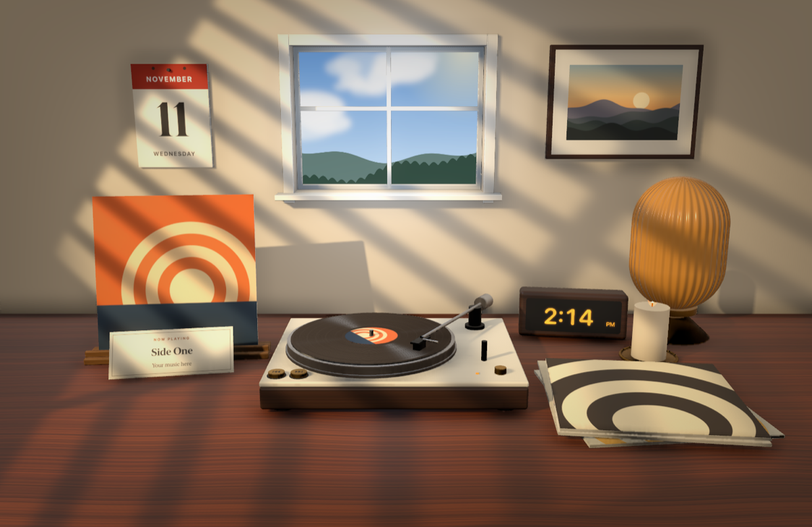
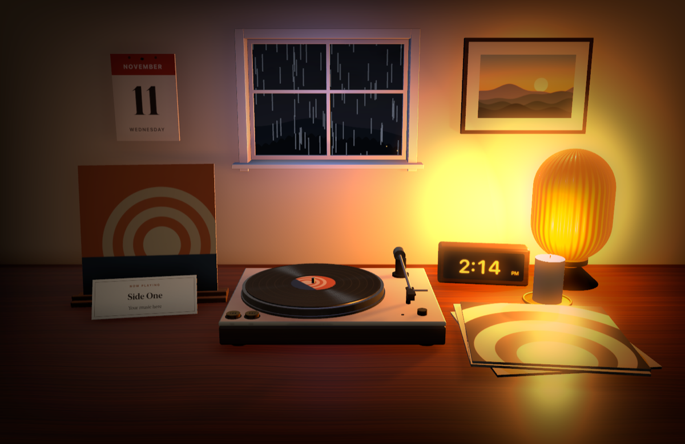
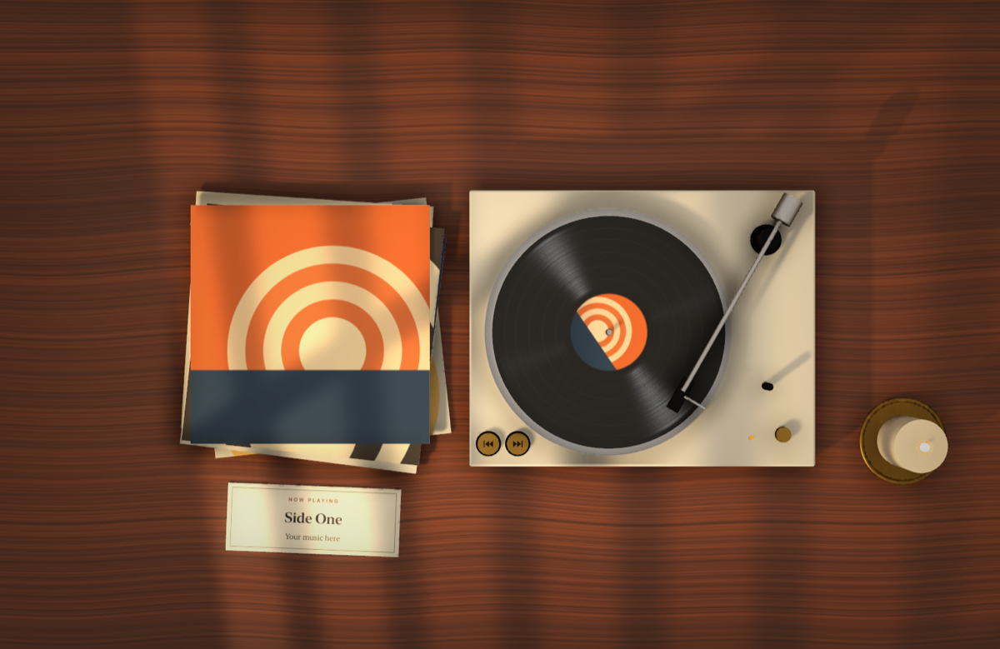

# hearth

A small room that lives on my Mac desktop. It sits behind every window as the wallpaper,
and I choose what goes in it: a record player that follows Spotify or Apple Music, a clock,
a candle, a calendar, a lamp, and a window showing the real weather outside.

Personal project. Everything on screen is rendered live with SceneKit and every texture
(wood, grooves, sky, lamp glass, placeholder sleeves) is drawn in code, so there are no image assets.

| Daylight | Lamplight | Top Down |
| --- | --- | --- |
|  |  |  |

## What goes in the room

Each of these can be switched on or off on its own, in any combination:

- **Record player** — spins at 33⅓ rpm while music plays, with the real album cover on a stand and a card naming the song
- **Played records** — every new song drops the previous cover onto a stack
- **Lamp** — lights the room in the evening scene
- **Clock** — a walnut block with glowing digits, in your Mac's 12 or 24 hour format
- **Candle** — the flame flickers and lights the desk at night
- **Calendar** — a tear-off wall calendar that turns over at midnight
- **Window** — shows the live weather where you are: clear, cloudy, fog, rain, snow or storm, by day or night. The room's light dims with the clouds.

With the record player switched off, the clock moves to the middle of the desk.

## What else it does

- Three scenes: **Daylight**, **Lamplight** and **Top Down**
- Follows the clock: Daylight from 6:30 am, Lamplight after 6:30 pm (can be turned off)
- Click the tonearm (or the brass knob) on the desktop to play or pause
- Two brass buttons on the deck skip to the previous or next song
- Album covers come from Spotify and Apple Music, no login
- Transparent mode puts the items on your own wallpaper
- Menu bar icon for scenes, playback, settings and quit
- Stops rendering completely when nothing is moving (no music, candle, rain or snow)

## Weather and privacy

Live weather needs no account or key. Once a day the app asks ipwho.is for a rough location
based on the public IP address, rounds it to about 10 km, and then asks Open-Meteo for the
current conditions there every 20 minutes. To avoid both requests, pick a weather by hand in settings.

## Build and install

Needs Xcode command line tools (Swift 5.9+) and macOS 14 or later.

```bash
./scripts/build-app.sh --install
```

That builds `dist/Hearth.app`, copies it to `/Applications` and launches it.

The first time it talks to Spotify or Music, macOS asks whether Hearth may control that app.
Say yes: it is used to read the current track at launch and for play, pause and skip.

## Development

Render a still of each scene without launching the app:

```bash
swift build -c release && .build/release/Hearth --snapshot /tmp --items clock,candle,window --weather snow --size small
```

While the app runs, `kill -USR1 $(pgrep -x Hearth)` writes what the desktop currently shows
to `~/Library/Caches/com.abrj7.hearth/live.png`.

## Layout

| File | What it holds |
| --- | --- |
| `Textures.swift` | Procedural textures, skies and built-in artwork |
| `DeskScene.swift` | The room, record player, scene presets, lighting and animation |
| `Items.swift` | Clock, candle, calendar and window |
| `Weather.swift` | Live weather lookup |
| `NowPlaying.swift` | Spotify / Apple Music playback monitor |
| `Artwork.swift` | Album cover lookup |
| `DesktopController.swift` | Wallpaper-level window, click handling, settings state |
| `AppDelegate.swift` | Menu bar item and wiring |
| `SettingsView.swift` | Settings window |
